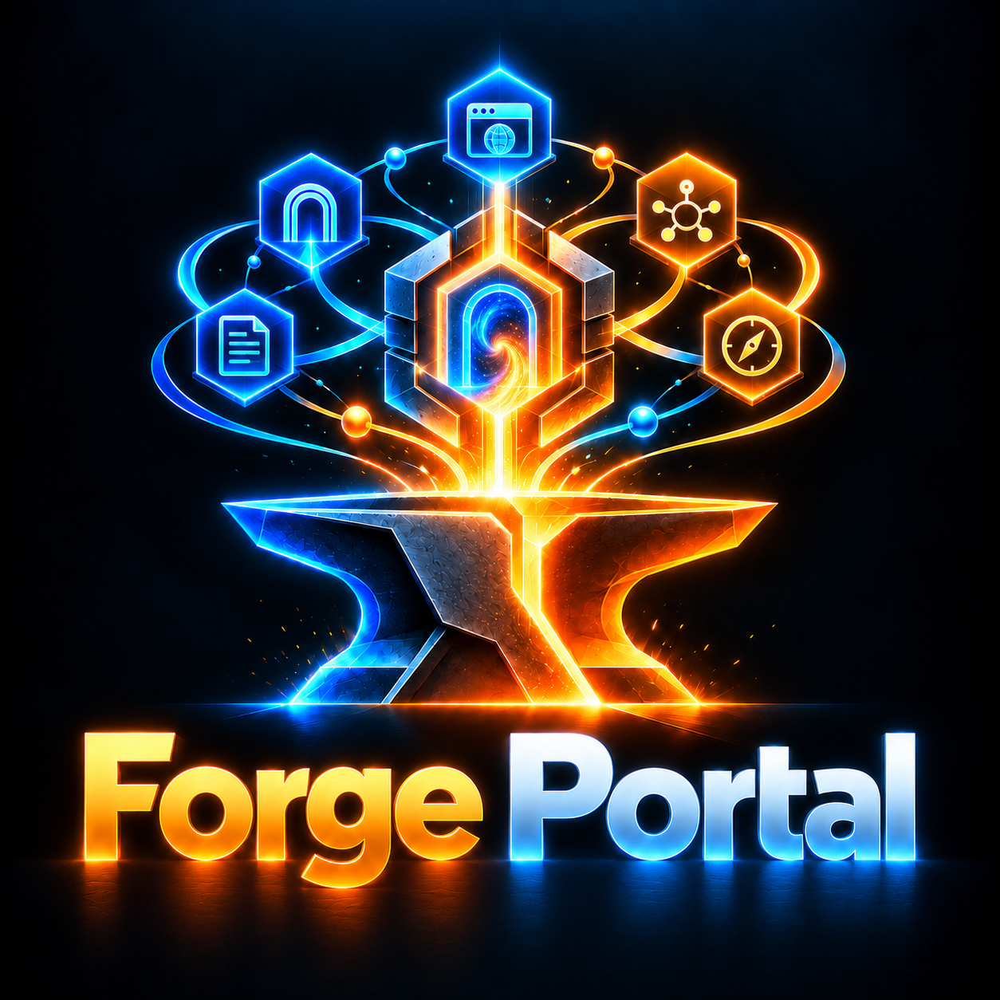

<p align="center">
  
</p>

# Forge Portal

Portal web local e opcional para o ecossistema The Forge — um centro de
controle Angular único que expõe, de forma simples e visual, as
capacidades reais de cada Forja (instalação, hosts de IA, MCP, skills,
agents, tarefas, Graph Studio, documentação) sem substituir CLI, TUI ou
motores existentes.

- **Stack**: Angular 22 (standalone, signals, lazy routes, zoneless) +
  servidor Python stdlib vendored em cada Forja. PT-BR e English nativos
  com troca imediata em runtime.
- **Distribuição**: `scripts/vendor.py` copia o bundle compilado e o
  módulo `_forge_portal.py` para cada repositório irmão; cada Forja
  serve o portal via `<cli> portal` — Node.js só é dependência de
  desenvolvimento aqui.
- **Contratos**: `forge/PortalApi/1` — ver `docs/fase0/contracts.md`.
- **Onboarding federado**: a página `/federation` reúne catálogo, escopo,
  hosts, perfis, componentes e o fluxo `plan → review → confirm` da família.
- **Arquitetura e decisões**: `docs/fase0/architecture.md`,
  `docs/fase0/security-matrix.md`, `docs/fase0/capability-map.md`,
  `docs/fase0/distribution-plan.md`.

## Desenvolvimento

```bash
npm install
npm start          # dev server Angular (ng serve) — o backend Python vem da Forja
npm run build      # dist/forge-portal-app — artefato de release (vendorable)
npm test           # testes unitários (vitest)
```

Gates de qualidade deste repo:

| Comando          | Para quê / quando usar |
|------------------|------------------------|
| `npm run build`  | Antes de commitar — prova que compila e gera o bundle a ser vendored. |
| `npm test`       | Sempre — unidade de stores, i18n, api client e páginas. |
| `npx prettier --check "src/**/*"` | Antes de commitar — estilo canônico (`.prettierrc`). |
| `python -m pytest tests/` | Quando `server/` existir (FASE 2) — testes do backend stdlib. |
| `python scripts/vendor.py` | Após um build de release — propaga o bundle + `_forge_portal.py` para as 7 Forjas. |

## Princípios

Read-only por padrão; mutações seguem plan → review → confirm →
execute → verify → receipt; nenhum botão fictício; nenhum estado
inventado; o portal usa os mesmos serviços e produz os mesmos receipts
do CLI/TUI.
