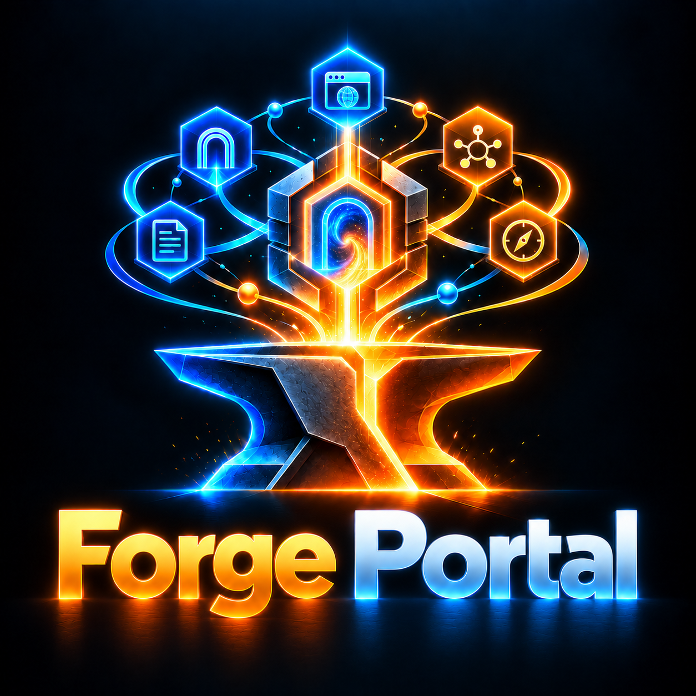

<p align="center">
  
</p>

# Forge Portal

Portal web local e opcional para o ecossistema The Forge — um centro de
controle Angular único que expõe, de forma simples e visual, as
capacidades reais de cada Forja (instalação, hosts de IA, MCP, skills,
agents, tarefas, Graph Studio, documentação) sem substituir CLI, TUI ou
motores existentes.

- **Stack**: Angular 22 (standalone, signals, lazy routes, zoneless) +
  servidor Python stdlib vendored em cada Forja. PT-BR e English nativos
  com troca imediata em runtime.
- **Distribuição**: `scripts/vendor.py` copia o bundle compilado e o
  módulo `_forge_portal.py` para cada repositório irmão; cada Forja
  serve o portal via `<cli> portal` — Node.js só é dependência de
  desenvolvimento aqui.
- **Contratos**: `forge/PortalApi/1` — ver `docs/fase0/contracts.md`.
- **Onboarding federado**: a página `/federation` reúne catálogo, escopo,
  hosts, perfis, componentes e o fluxo `plan → review → confirm` da família.
- **Arquitetura e decisões**: `docs/fase0/architecture.md`,
  `docs/fase0/security-matrix.md`, `docs/fase0/capability-map.md`,
  `docs/fase0/distribution-plan.md`.

## Desenvolvimento

```bash
npm install
npm start          # dev server Angular (ng serve) — o backend Python vem da Forja
npm run build      # dist/forge-portal-app — artefato de release (vendorable)
npm test           # testes unitários (vitest)
npm run test:cli   # contrato CLI/TUI/Wizard sem depender de um TTY
node tools/portal-cli.mjs   # home TUI; wizard e status ficam no mesmo comando
```

### Instalação local portátil

Para instalar o Portal diretamente a partir deste repositório, com build e
comando local `forge-portal`, use a rota do seu terminal:

```bash
./install.sh
powershell -ExecutionPolicy Bypass -File .\install.ps1 -NoLink
bash install.windows.sh --no-link
```

O instalador mostra um plano sem alterar nada com `--dry-run`. O `-NoLink` /
`--no-link` deixa o bundle apenas no repositório; a distribuição das Forjas em
produção continua sendo feita por `scripts/vendor.py`.

### CLI portátil

O Portal também possui uma superfície terminal mínima e útil, sem dependências
adicionais: `forge-portal` abre a home TUI em um terminal, `forge-portal wizard`
guia host/porta com confirmação explícita, e `forge-portal status` produz o
contrato local. Em pipes e CI, o mesmo fluxo degrada para JSON honesto; o
servidor web só é iniciado pelo comando explícito de start. O pacote publicado
inclui o bundle Angular e, quando instalado fora do checkout, `forge-portal start`
usa um servidor estático Node embutido; assim a instalação de produção
não depende de `@angular/cli` ou de um diretório do repositório:

```bash
npm install forge-portal-app
npx forge-portal
npx forge-portal status
npx forge-portal start
```

No checkout, onde as dependências de desenvolvimento existem, `start` continua
delegando para `ng serve`.

Gates de qualidade deste repo:

| Comando                           | Para quê / quando usar                                                             |
| --------------------------------- | ---------------------------------------------------------------------------------- |
| `npm run build`                   | Antes de commitar — prova que compila e gera o bundle a ser vendored.              |
| `npm test`                        | Sempre — unidade de stores, i18n, api client e páginas.                            |
| `npx prettier --check "src/**/*"` | Antes de commitar — estilo canônico (`.prettierrc`).                               |
| `python -m pytest tests/`         | Testes do backend stdlib (`portal_core/`).                                         |
| `python -m pytest e2e/`           | E2E em Chromium real contra o bundle (`playwright` em `requirements-dev.txt`).     |
| `python3 scripts/check_i18n.py`   | Paridade de chaves pt-BR/en — trava drift de i18n.                                 |
| `ruff check portal_core tests scripts e2e` | Lint Python.                                                              |
| `python scripts/vendor.py`        | Após um build de release — propaga o bundle + `_forge_portal.py` para as 7 Forjas. |

## Princípios

Read-only por padrão; mutações seguem plan → review → confirm →
execute → verify → receipt; nenhum botão fictício; nenhum estado
inventado; o portal usa os mesmos serviços e produz os mesmos receipts
do CLI/TUI.
